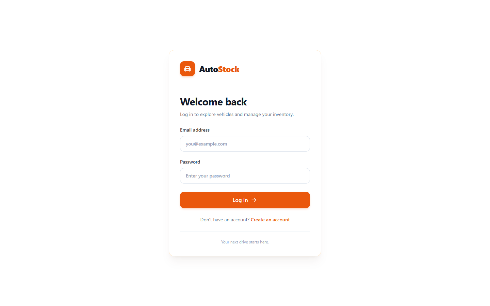
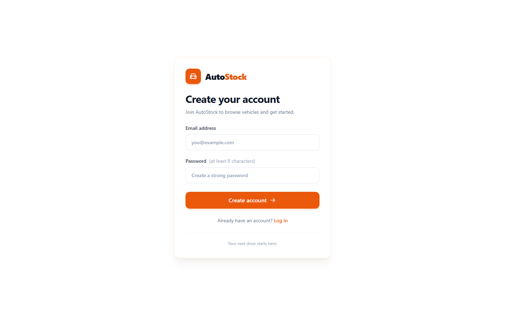
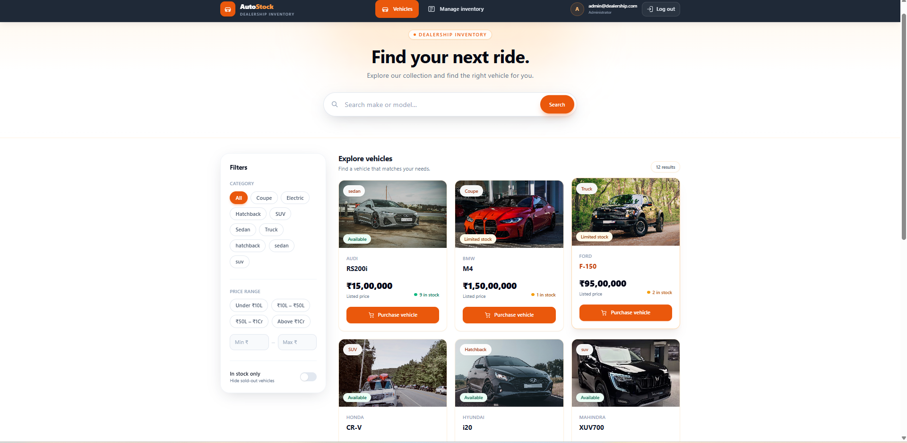
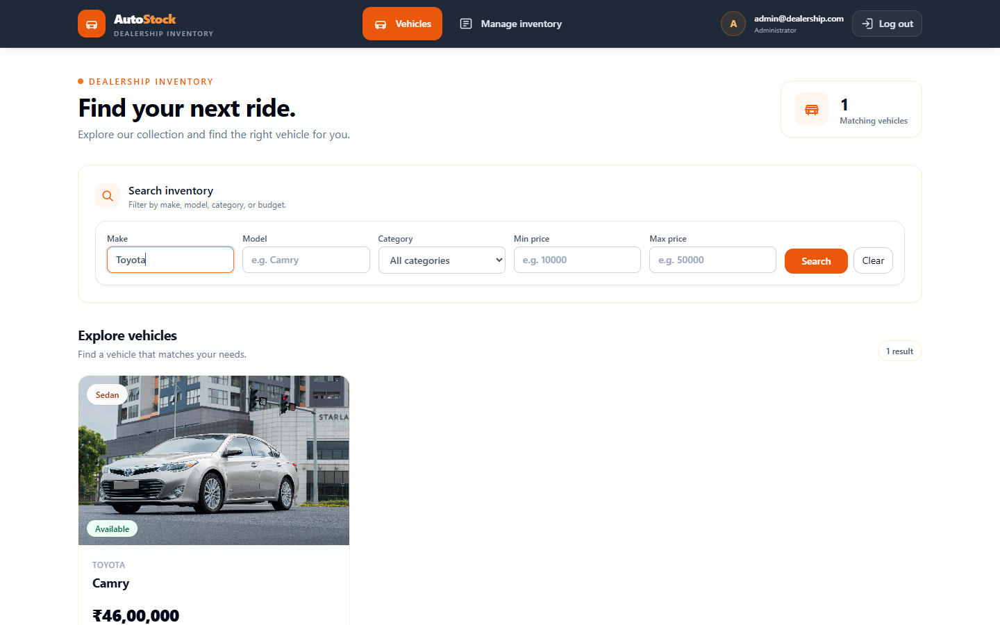
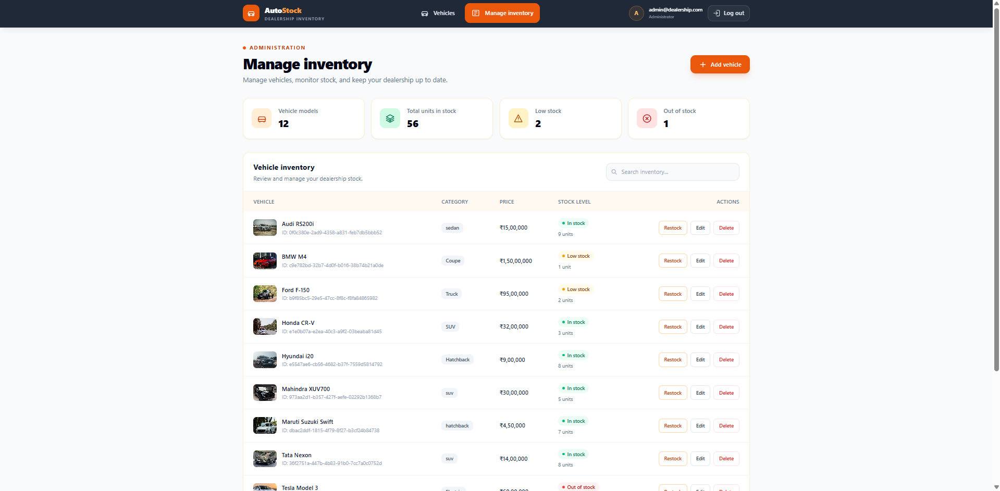
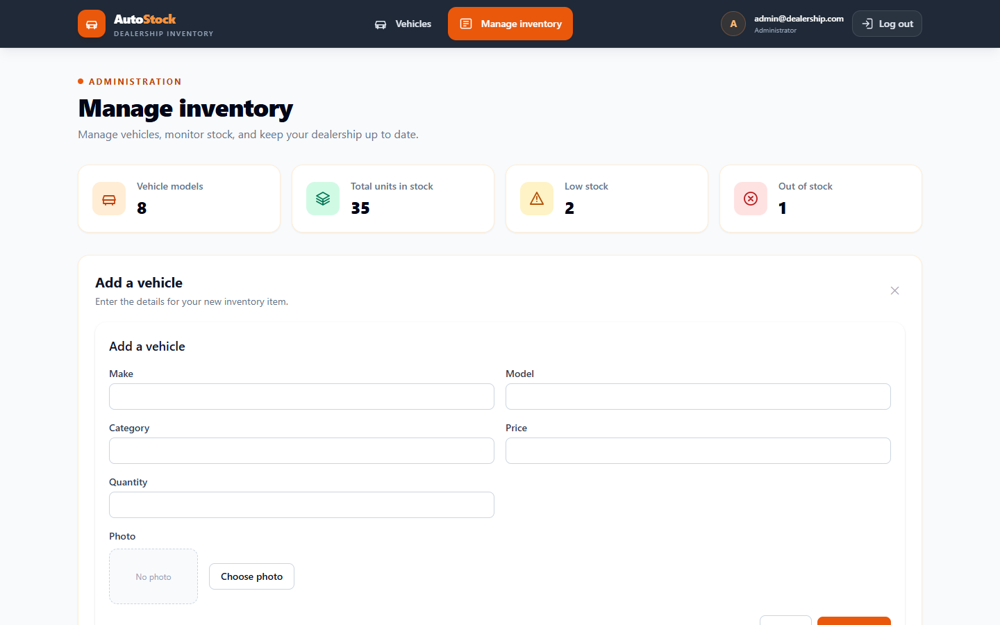
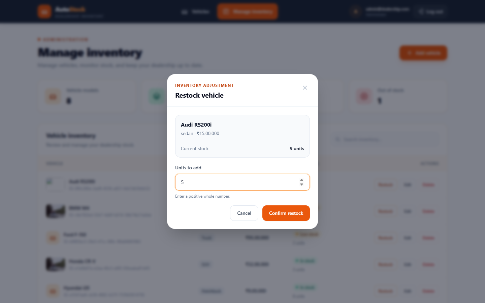
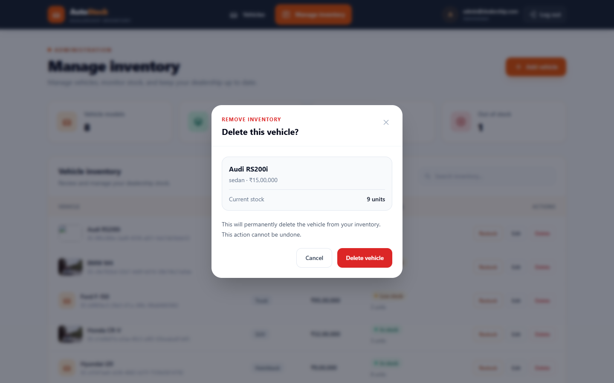
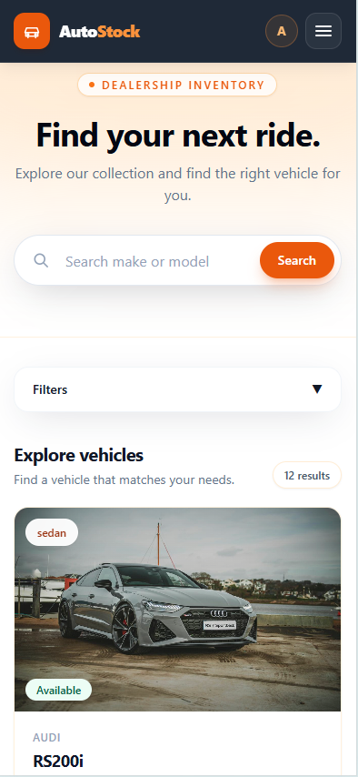

# AutoStock — Car Dealership Inventory System

A full-stack inventory system for a car dealership, built test-first as a TDD kata.
Customers can register, browse and search the showroom, and purchase vehicles.
Administrators can add, edit, delete and restock vehicles, and upload vehicle photos.

- **Backend:** REST API in Node.js, TypeScript and Express, with Prisma on SQLite and JWT authentication
- **Frontend:** single-page app in React, TypeScript, Tailwind CSS and Vite
- **Tests:** Jest and Supertest on the backend, Vitest and Testing Library on the frontend


---

## Table of contents

- [Features](#features)
- [Tech stack](#tech-stack)
- [Architecture](#architecture)
- [API reference](#api-reference)
- [Getting started](#getting-started)
- [Running the tests](#running-the-tests)
- [Test report](#test-report)
- [Screenshots](#screenshots)
- [My AI Usage](#my-ai-usage)

---

## Features

**All users**
- Register and log in. Logging in returns a JWT, which the client stores and sends with every API request.
- Browse every vehicle on a dashboard with photo cards, stock badges and prices in INR.
- Search and filter by make, model, category and price range.
- Purchase a vehicle. The button is disabled when a vehicle is out of stock.

**Administrators**
- Add and edit vehicles through a reusable form.
- Delete a vehicle or restock it, each behind a confirmation dialog.
- Upload a vehicle photo. Photos are stored on local disk in development or on Cloudinary in production.
- See an inventory overview: number of models, total units, low stock and out of stock.

**Throughout**
- A responsive layout that works from phone to desktop.
- Validation on both sides, with clear error messages.
- Routes are protected on the client, and roles are enforced on the server.

## Tech stack

| Layer | Technology |
|---|---|
| API | Node.js, TypeScript, Express 5 |
| Database | SQLite through Prisma ORM |
| Auth | JSON Web Tokens (`jsonwebtoken`) and `bcryptjs` password hashing |
| Validation | Zod |
| Security | Helmet, CORS |
| Uploads | Multer, with pluggable local or Cloudinary storage |
| Frontend | React 18, TypeScript, React Router 6, Axios |
| Styling | Tailwind CSS 3 |
| Build | Vite 5 |
| Backend tests | Jest, Supertest, and a separate SQLite test database |
| Frontend tests | Vitest, React Testing Library, jsdom |

## Architecture

The backend is split into feature modules. Each module has the same layers, and each layer depends only on the layer below it:

```
routes  →  controller  →  service  →  repository  →  Prisma / database
 (HTTP)    (req/res)      (rules)     (data access)
```

- **Routes** wire up the middleware (`authenticate`, `authorize("ADMIN")`) and map URLs to controller methods.
- **Controllers** parse the request with Zod schemas and shape the HTTP response.
- **Services** hold the business rules. For example, a purchase is refused when stock is zero, and a restock amount must be positive.
- **Repositories** are behind interfaces, so services never depend on Prisma directly (dependency inversion).
- Errors are raised as `AppError` and turned into consistent JSON responses by one error-handling middleware.
- Image storage sits behind an `ImageStorage` interface. `LocalImageStorage` and `CloudinaryImageStorage` can be swapped with the `STORAGE_DRIVER` environment variable without touching the service.

```
backend/
├── prisma/            # schema, migrations, seed script
├── src/
│   ├── app.ts         # Express app (exported for tests)
│   ├── server.ts      # starts the HTTP server
│   ├── errors/        # AppError
│   ├── middleware/    # auth (authenticate / authorize), error handler
│   └── modules/
│       ├── auth/      # register, login, JWT
│       ├── vehicles/  # CRUD, search, purchase, restock
│       └── uploads/   # image upload and storage drivers
└── tests/integration/ # Supertest suites, one per feature

frontend/
├── public/cars/       # seed vehicle photos
└── src/
    ├── api/           # typed Axios client and API functions
    ├── context/       # AuthContext (token, user, role)
    ├── components/    # Navbar, VehicleCard, VehicleForm, SearchBar, ImageUpload, ...
    ├── pages/         # Login, Register, Dashboard, Admin
    └── utils/         # INR price formatter
```

## API reference

Base URL: `http://localhost:3000/api`. Every route except `/auth/*` needs an `Authorization: Bearer <token>` header.

| Method | Endpoint | Access | Description |
|---|---|---|---|
| POST | `/auth/register` | Public | Create an account and return the new user |
| POST | `/auth/login` | Public | Log in and get a token |
| GET | `/vehicles` | User | List all vehicles |
| GET | `/vehicles/search` | User | Filter by `make`, `model`, `category`, `minPrice`, `maxPrice` |
| POST | `/vehicles` | User | Add a vehicle |
| PUT | `/vehicles/:id` | User | Update a vehicle (partial updates are allowed) |
| DELETE | `/vehicles/:id` | **Admin** | Delete a vehicle |
| POST | `/vehicles/:id/purchase` | User | Buy one unit, which decreases quantity by 1 |
| POST | `/vehicles/:id/restock` | **Admin** | Increase quantity by `{ "quantity": n }` |
| POST | `/uploads` | **Admin** | Upload a vehicle image (multipart, field `image`) |

A vehicle has a unique `id` (UUID), plus `make`, `model`, `category`, `price`, `quantity` and an optional `imageUrl`.

Every error uses the same JSON shape, `{ "error": "..." }`, with the matching status code: 400 for validation errors, 413 for an image over 2 MB, 401 without a valid token, 403 for the wrong role, 404 when a vehicle isn't found, and 409 for a duplicate email or for purchasing a vehicle that's out of stock.

## Getting started

### Prerequisites

- Node.js 20 or newer, and npm
- Git

### 1. Clone

```bash
git clone https://github.com/Shubhankamin/car-dealership.git
cd car-dealership
```

### 2. Backend

```bash
cd backend
npm install
cp .env.example .env          # on Windows PowerShell: copy .env.example .env
```

Edit `.env` if needed:

| Variable | Default | Purpose |
|---|---|---|
| `DATABASE_URL` | `file:./dev.db` | SQLite database file |
| `JWT_SECRET` | — | **Set a long random string** |
| `PORT` | `3000` | API port |
| `ADMIN_EMAIL` / `ADMIN_PASSWORD` | `admin@dealership.com` / `Admin12345` | Admin account created by the seed script |
| `STORAGE_DRIVER` | `local` | `local` or `cloudinary` |
| `CLOUDINARY_URL` | — | Needed only when `STORAGE_DRIVER=cloudinary` |

Create the database, load sample data and start the API:

```bash
npx prisma migrate dev        # creates dev.db and applies the migrations
npm run seed                  # adds the admin user and sample vehicles
npm run dev                   # http://localhost:3000
```

### 3. Frontend

In a second terminal:

```bash
cd frontend
npm install
npm run dev                   # http://localhost:5173
```

The Vite dev server forwards `/api` requests to `http://localhost:3000`, so no extra setup is needed locally.
For a production build, set `VITE_API_URL` to the deployed backend URL.

### 4. Log in

- **Admin:** `admin@dealership.com` / `Admin12345`, or whatever you set in `.env`
- **Customer:** register a new account from the sign-up page

### Production build

```bash
cd backend  && npm run build && npm start
cd frontend && npm run build              # output in frontend/dist
```

## Running the tests

```bash
cd backend
npm test                  # all backend suites
npm run test:coverage     # with a coverage report

cd frontend
npm test                  # all frontend suites
```

The backend tests are integration tests. They send real HTTP requests to the Express app with Supertest and run against a separate SQLite test database (`test.db`), which is cleared before each test.

### TDD workflow

Every feature was built Red → Green → Refactor, and the commit history shows it:

```
test: add failing tests for user login            ← RED
feat: implement login endpoint with JWT           ← GREEN
...
test: add failing test for the INR price formatter
feat: show all prices in INR with one shared formatter
refactor: remove unused favorites and update card tests   ← REFACTOR
```

## Test report

All tests below were run on the `dev` branch.

### Backend — Jest and Supertest

```
Test Suites: 8 passed, 8 total
Tests:       50 passed, 50 total
```

| Suite | Tests |
|---|---|
| `auth.register.test.ts` | 4 |
| `auth.login.test.ts` | 3 |
| `middleware.test.ts` | 5 |
| `vehicles.create.test.ts` | 5 |
| `vehicles.read.test.ts` | 7 |
| `vehicles.modify.test.ts` | 9 |
| `vehicles.inventory.test.ts` | 10 |
| `uploads.test.ts` | 7 |

**Coverage**

| Statements | Branches | Functions | Lines |
|---|---|---|---|
| 94.44 % | 69.73 % | 92.30 % | 95.03 % |

| Module | Lines |
|---|---|
| `modules/auth` | 100 % |
| `modules/vehicles` | 98.98 % |
| `middleware` | 89.65 % |
| `modules/uploads` | 85.24 % |

The lowest coverage is in the Cloudinary storage driver. It talks to an external service, so the tests run against the local driver instead.

### Frontend — Vitest and React Testing Library

```
Test Files  5 passed (5)
     Tests  15 passed (15)
```

```
✓ currency.test.ts      formats rupees with the rupee symbol
✓ currency.test.ts      uses Indian digit grouping for lakhs and crores
✓ VehicleCard.test.tsx  shows the vehicle details
✓ VehicleCard.test.tsx  calls onPurchase with the vehicle id when Purchase is clicked
✓ VehicleCard.test.tsx  disables the button and shows Out of stock when quantity is zero
✓ VehicleCard.test.tsx  shows the vehicle photo when one is provided
✓ ImageUpload.test.tsx  uploads the chosen file and reports the new url
✓ ImageUpload.test.tsx  rejects a file that is not an image without calling the API
✓ ImageUpload.test.tsx  shows the message when the upload fails
✓ ImageUpload.test.tsx  shows a preview and a replace button when a photo is set
✓ VehicleForm.test.tsx  submits the values for a new vehicle
✓ VehicleForm.test.tsx  pre-fills the fields when editing
✓ VehicleForm.test.tsx  calls onCancel
✓ LoginPage.test.tsx    logs in and redirects to the home page
✓ LoginPage.test.tsx    shows the error message when login fails
```

## Screenshots

### Login and registration

| Login | Register |
|---|---|
|  |  |

### Dashboard

All vehicles, with stock badges. The Purchase button is disabled when a vehicle is sold out.



### Search and filter



### Admin — manage inventory



| Add vehicle, with photo upload | Restock | Delete confirmation |
|---|---|---|
|  |  |  |

### Mobile



## My AI Usage

### Tools I used

- **Claude (Anthropic), through — my main assistant for the backend and the TDD flow.
- **ChatGPT (OpenAI)** — used for the UI redesign (the AutoStock theme).

Every commit where an AI tool helped has a `Co-Authored-By` trailer naming the tool. The raw chat logs are in [PROMPTS.md](PROMPTS.md).

### How I used them

- **Planning and structure:** I used Claude to discuss the layered module structure (routes → controller → service → repository) and the order to build the endpoints in.
- **Writing failing tests first:** for each endpoint I asked Claude to help draft the Supertest cases, including edge cases such as duplicate emails, purchasing when stock is zero, `minPrice > maxPrice`, and wrong roles. I committed them as red before writing any implementation.
- **Implementation:** I used Claude to help implement the services, controllers and middleware until the tests passed, and reviewed and adjusted the code myself.
- **Frontend:** Claude helped set up Vite, Tailwind and Vitest, the typed API client, the auth context, and the component tests. ChatGPT helped redesign the login, register, dashboard and admin pages, and the shared components, into the AutoStock theme.
- **Debugging and Git:** I used Claude to help recover from a bad merge of the image-upload branch and to check that the final merge was safe.

### Reflection

- AI played a major role in building this project. It helped me generate boilerplate code, establish the folder structure, implement features, and style the user interface, which made development faster.

- However, I learned that AI-generated code should not be accepted blindly. Sometimes the code did not match my requirements, followed generic patterns, or introduced unnecessary complexity. I reviewed the suggestions, modified the structure, variable naming, and coding style to suit my preferences, and used only the solutions that made sense for the project.

- Following Test-Driven Development (TDD) helped me identify cases where the implementation failed to meet the expected behavior. Writing and running tests helped me understand potential failure scenarios, validate the requirements, and refine the implementation until the tests passed.

- Going forward, I want to improve my understanding of code architecture, folder organization, and maintainable design principles. I also plan to extend this project with additional features while maintaining good test coverage and code quality.
